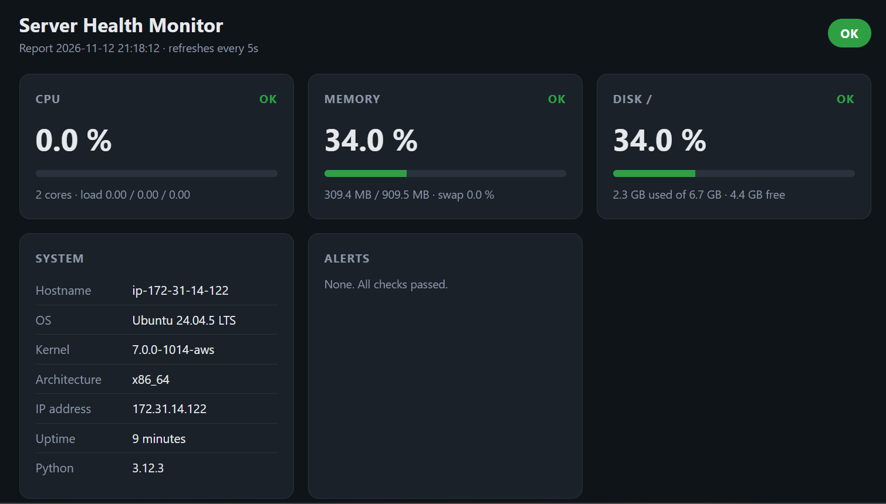
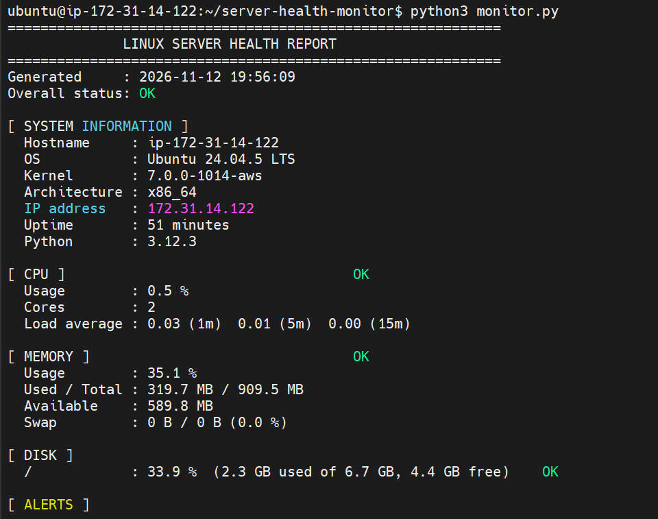
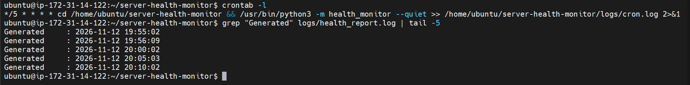

# Linux Server Health Monitor

A lightweight Python tool that checks the health of a Linux server and reports:

- **CPU utilization**: usage %, core count, 1/5/15-minute load average
- **RAM usage**: used / total / available memory, plus swap
- **Disk utilization**: usage % and free space for one or more mount points
- **System information**: hostname, OS, kernel, architecture, IP address, uptime

It combines these into a **health report** with an `OK` / `WARNING` / `CRITICAL` status for each check and saves every report to a **log file** (`logs/health_report.log`, rotated automatically).

It uses **only the Python standard library** and reads Linux's `/proc` files directly, so there is nothing to `pip install`.

It also has a **web dashboard** (port 5000) with a JSON API, and it is **deployed on AWS EC2**, where cron runs it every 5 minutes. See [Deployed on AWS](#deployed-on-aws).

## Requirements

- Linux (Ubuntu, Amazon Linux, CentOS, Debian, etc.)
- Python 3.8 or newer (`python3 --version`)
- Git (to clone the project)

## Quick start

```bash
git clone https://github.com/samuelpremmm/server-health-monitor.git
cd server-health-monitor
python3 -m health_monitor
```

or, equivalently:

```bash
python3 monitor.py
```

## Usage

```text
python3 -m health_monitor [options]

  --disk PATH         mount point to check (repeat for more, default: /)
  --log-file FILE     where to append reports (default: logs/health_report.log)
  --interval SEC      seconds between the two CPU samples (default: 1)
  --watch SEC         keep running and produce a report every SEC seconds
  --json              print and log the report as JSON
  --quiet             write the log file only, print nothing
  --cpu-warn / --cpu-crit     CPU thresholds in %    (default 75 / 90)
  --mem-warn / --mem-crit     memory thresholds in % (default 75 / 90)
  --disk-warn / --disk-crit   disk thresholds in %   (default 80 / 90)
  --version
```

Examples:

```bash
python3 -m health_monitor --disk / --disk /home          # check two mount points
python3 -m health_monitor --watch 60                     # report every minute (Ctrl+C to stop)
python3 -m health_monitor --json --log-file logs/health.jsonl
python3 -m health_monitor --cpu-warn 60 --cpu-crit 80    # stricter CPU limits
```

**Exit codes:** `0` = OK, `1` = WARNING, `2` = CRITICAL, `3` = not running on Linux. This makes the tool easy to use from cron, shell scripts or monitoring systems.

## Sample report

```text
============================================================
              LINUX SERVER HEALTH REPORT
============================================================
Generated     : 2026-11-10 10:00:00
Overall status: WARNING

[ SYSTEM INFORMATION ]
  Hostname     : web-01
  OS           : Ubuntu 24.04 LTS
  Kernel       : 6.8.0-1012-aws
  Architecture : x86_64
  IP address   : 172.31.20.15
  Uptime       : 3 days, 4 hours, 0 minutes
  Python       : 3.12.3

[ CPU ]                                   OK
  Usage        : 40.0 %
  Cores        : 2
  Load average : 0.52 (1m)  0.38 (5m)  0.30 (15m)

[ MEMORY ]                                WARNING
  Usage        : 75.0 %
  Used / Total : 5.7 GB / 7.6 GB
  Available    : 1.9 GB
  Swap         : 488.3 MB / 1.9 GB (25.0 %)

[ DISK ]
  /            : 52.3 %  (15.7 GB used of 30.0 GB, 14.3 GB free)    OK

[ ALERTS ]
  - Memory usage 75.0% is WARNING (warning 75.0%, critical 90.0%)
============================================================
```

## Run automatically with cron

```bash
bash scripts/install_cron.sh        # every 5 minutes
bash scripts/install_cron.sh 15     # every 15 minutes
crontab -l                          # confirm the job
tail -f logs/health_report.log      # watch reports arrive
```

## Web dashboard

```bash
python3 -m health_monitor.web              # live data on http://<server>:5000
python3 -m health_monitor.web --port 8080  # another port (or set $PORT)
python3 -m health_monitor.web --demo       # sample data, works on Windows/macOS
```

| URL | What it returns |
|-----|-----------------|
| `/` | Dashboard page with CPU, memory, disk, system info and alerts; refreshes every 5 seconds |
| `/api/health` | The full report as JSON |
| `/healthz` | `{"status": "ok"}`, a liveness check for Docker and load balancers |

It is built on Python's `http.server`, so there is still nothing to install. Metrics are cached for 2 seconds, so many viewers don't trigger repeated CPU sampling.

> On a cloud server, open port 5000 **only to your own IP** (`x.x.x.x/32`) in the firewall / security group, never to `0.0.0.0/0`.

## Run with Docker

```bash
docker build -t health-monitor .
docker run -d --name health-monitor -p 5000:5000 --hostname "$(hostname)" \
  -v /:/host:ro -e DISK_PATHS=/host --restart unless-stopped health-monitor
docker ps          # STATUS shows (healthy) once /healthz answers
```

The image is `python:3.12-slim`, runs as a non-root user and has a `HEALTHCHECK` on `/healthz`. The read-only `/host` mount lets the container report the server's real disk; CPU and memory already come from the host's `/proc`.

## Deployed on AWS

The tool runs on an **AWS EC2** Ubuntu 24.04 server (t3.micro, Mumbai `ap-south-1`):

- Security group allows SSH (22) and the dashboard (5000) **only from my IP (/32)**
- Key-based SSH, MFA on the account, an IAM user for daily work, and a zero-spend budget alert
- cron runs a health check every 5 minutes
- The dashboard runs 24/7, first as a systemd service, now as a Docker container with `--restart unless-stopped`



Step-by-step guide with screenshots: [docs/HEALTH_MONITOR_SERVER.md](docs/HEALTH_MONITOR_SERVER.md)

| Health report on EC2 | Cron every 5 minutes |
|---|---|
|  |  |

## Run the tests

```bash
python3 -m unittest discover -s tests -v
```

The tests use saved copies of `/proc` files in `tests/fixtures/`, so they run on any OS.

To see a full report on a non-Linux machine (CPU and memory come from the sample `/proc` files; disk is real):

```bash
python3 scripts/demo_with_fixtures.py
```

## Project structure

```text
server-health-monitor/
├── health_monitor/
│   ├── __init__.py       version
│   ├── __main__.py       command-line interface
│   ├── cpu.py            CPU usage from /proc/stat, load from /proc/loadavg
│   ├── memory.py         RAM and swap from /proc/meminfo
│   ├── disk.py           disk usage via shutil.disk_usage
│   ├── sysinfo.py        hostname, OS, kernel, IP, uptime
│   ├── report.py         thresholds, report text, log file
│   └── web.py            web dashboard + JSON API (port 5000)
├── tests/
│   ├── fixtures/         sample /proc files
│   ├── test_health_monitor.py
│   └── test_web.py
├── scripts/install_cron.sh
├── logs/                 reports are written here
├── docs/
│   ├── HEALTH_MONITOR_SERVER.md   AWS EC2 deployment guide
│   ├── PROJECT_DOCUMENTATION.md   design notes
│   ├── CICD_SETUP.md              Jenkins / SonarQube / Nexus pipeline
│   └── screenshots/
├── monitor.py            launcher
└── README.md
```

Full design notes, the step-by-step build, Git/GitHub workflow and testing details are in [docs/PROJECT_DOCUMENTATION.md](docs/PROJECT_DOCUMENTATION.md).

## Author

Chigurupati Prem Kumar, B.Tech CSE, Andhra University · AWS & DevOps Certified (Grade A)


