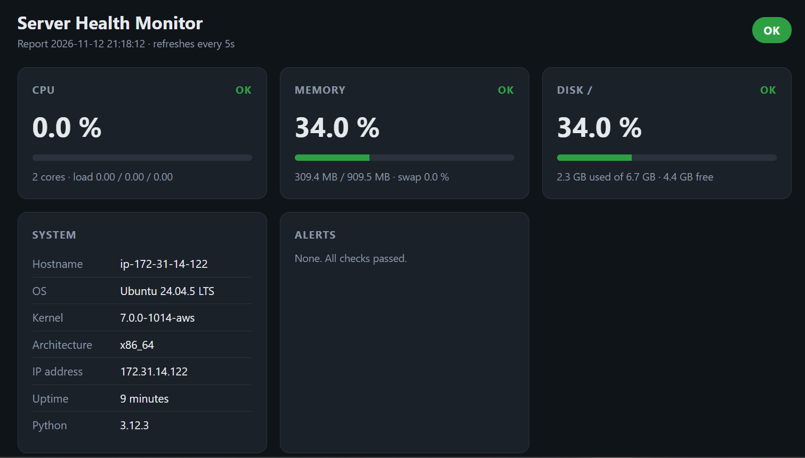
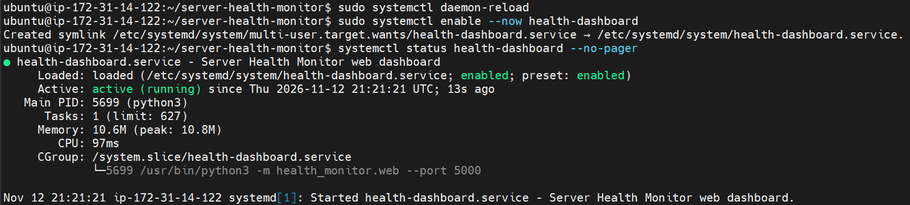
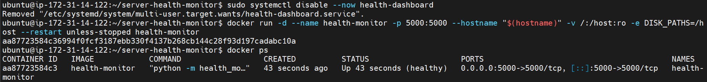
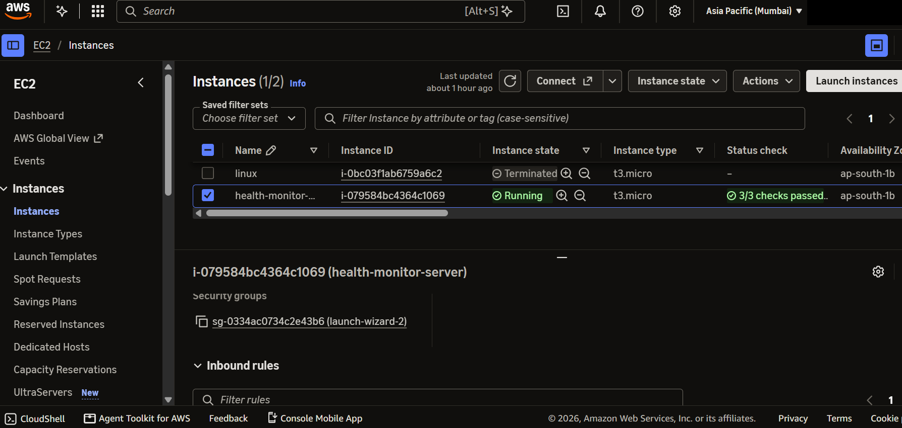
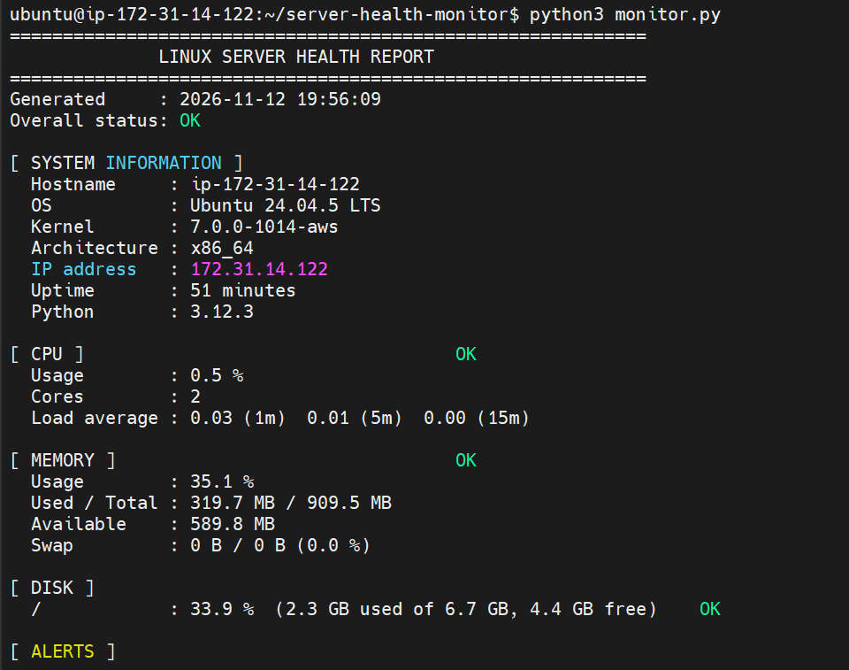
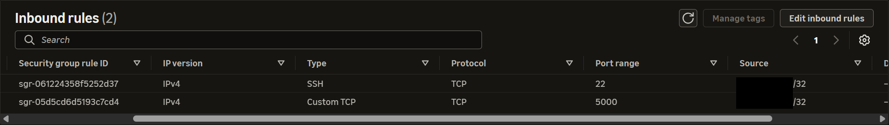
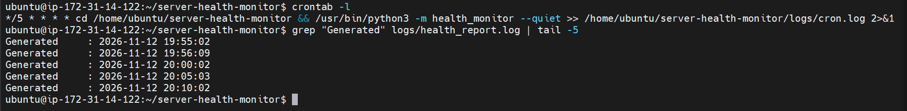

# HEALTH MONITOR SERVER

> **Status: DRAFT** — this document grows as we finish each step of the project.
> Last updated: 13 Nov 2026

A step-by-step record of deploying my **Linux Server Health Monitor** (a Python tool that checks CPU, RAM, disk and system info) on a real **AWS EC2** server, written in simple words so I can re-read it any time and explain it in interviews.

---

## Progress checklist

| # | Step | Status |
|---|------|--------|
| 0 | Create AWS account and secure it | ✅ Done |
| 1 | Launch EC2 instance and set security group (ports) | ✅ Done |
| 2 | Connect to the server with MobaXterm and the `.pem` key | ✅ Done |
| 3 | Install tools, clone project, run the health monitor | ✅ Done |
| 4 | Automate with cron (every 5 minutes) | ✅ Done |
| 5 | Web dashboard on port 5000 | ✅ Done |
| 6 | Run the dashboard 24/7 with systemd | ✅ Done |
| 7 | Docker | ✅ Done |
| 8 | CI/CD: auto deploy to EC2 on `git push` | ⏳ Next |
| 9 | Terraform (create AWS servers with code) | ⬜ Planned |
| 10 | Monitoring with Prometheus + Grafana | ⬜ Planned |

---

## Project overview

```
My laptop (MobaXterm)
      │  SSH on port 22 — allowed ONLY from my IP
      ▼
AWS Security Group (firewall)
      ▼
EC2 t3.micro — Ubuntu 24.04 — Mumbai (ap-south-1)
      └── server-health-monitor  (cloned from GitHub)
            ├── checks CPU / RAM / Disk / System info
            ├── runs automatically every 5 min (cron)
            └── saves reports → logs/health_report.log
```

**Project code:** https://github.com/samuelpremmm/server-health-monitor

---

## Step 0 — Create and secure the AWS account

| What I did | Why |
|------------|-----|
| Created an AWS account on the **Free plan** | Gives $100 credits; no card charges on the free plan |
| Turned on **MFA** (Authenticator app) for root | Password alone is not enough to log in → account stays safe |
| Created a **Zero spend budget** | AWS emails me as soon as anything starts costing money |
| Created an **IAM user** `devops-admin` | Root = owner account, too powerful. Daily work is done with an IAM user (real company practice) |
| Installed **AWS CLI** and **Terraform** on my laptop | AWS CLI = control AWS from terminal. Terraform = create servers using code (used later) |

**Lesson from my past:** my old AWS account was suspended because I left servers running and opened ports to the whole internet. This time: MFA, budget alert, ports open only to my IP, and stop/terminate servers after use.

---

## Step 1 — Launch the EC2 instance and set security ports

**EC2** = a virtual Linux computer rented from AWS.

### Steps in the AWS console

1. Sign in as **IAM user** (`devops-admin`), check region (top-right) = **Asia Pacific (Mumbai) ap-south-1**.
2. **EC2 → Launch instance**
3. **Name:** `health-monitor-server`
4. **AMI (operating system):** Ubuntu Server 24.04 LTS
5. **Instance type:** `t3.micro` (small and cheap — never pick bigger for practice)
6. **Key pair:** *Create new key pair* → name `health-monitor-key`, type **RSA**, format **.pem** → it downloads. **Keep it safe, never upload to GitHub.**
7. **Network settings → Edit → Security group** (see rules below)
8. **Storage:** 8 GB gp3 (default)
9. **Launch instance** → copy the **Public IPv4 address**

### Security group (the firewall)

A **security group** decides *who* can connect to the server and on *which port*.

| Type | Port | Source | Purpose |
|------|------|--------|---------|
| SSH | 22 | `<MY_IP>/32` | Log in to the server from MobaXterm |
| Custom TCP | 5000 | `<MY_IP>/32` | Web dashboard (next step) |

- **Port** = a "door" on the server. 22 = SSH door, 5000 = our app's door.
- **`/32`** = exactly one IP address (mine). Nobody else can connect.
- **Never use `0.0.0.0/0`** (= the whole internet) for SSH or admin tools.
- Find my current IP: open https://checkip.amazonaws.com

### Problem I faced and how I fixed it

| Problem | Cause | Fix |
|---------|-------|-----|
| MobaXterm could not connect (timed out) | "My IP" created **IPv6** rules, but my laptop connects using **IPv4** | Deleted both IPv6 rules, added new rules with **Source = Custom → `<MY_IP>/32`** (typed manually) |

**Tip:** My home/mobile IP can change. If SSH suddenly stops working, check my IP again and update the SSH rule.

**How the connection was tested** (PowerShell on laptop):

```powershell
Test-NetConnection <SERVER_PUBLIC_IP> -Port 22
```

`TcpTestSucceeded : True` = port is open for me. `False` = blocked (check security group / instance state).

---

## Step 2 — Connect to the server with MobaXterm and the .pem file

**SSH** = a secure way to open a terminal on a remote server.
**.pem file** = my private key. AWS keeps the matching public key on the server, so I log in with the key instead of a password.

### Steps

1. Open **MobaXterm → Session → SSH**
2. **Basic SSH settings**
   - **Remote host:** `<SERVER_PUBLIC_IP>`
   - Tick **Specify username:** `ubuntu` (default user on Ubuntu; Amazon Linux uses `ec2-user`)
   - **Port:** `22`
3. **Advanced SSH settings** → tick **Use private key** → select `health-monitor-key.pem`
4. Click **OK** → click **Accept** if asked about the server key (first time only)
5. Connected when I see a prompt like:

```
ubuntu@ip-172-31-xx-xx:~$
```

### Common errors

| Error | Meaning | Fix |
|-------|---------|-----|
| Connection timed out | Firewall is blocking | Security group SSH rule must have my current IP; instance must be *Running* |
| Server refused our key / Permission denied (publickey) | Wrong key or wrong username | Use the `.pem` of *this* instance, username `ubuntu` |
| Connection refused | Server still starting | Wait 1–2 min until status checks pass |

---

## Step 3 — Commands used on the server

| Command | Simple explanation |
|---------|--------------------|
| `sudo apt update` | Refresh Ubuntu's list of available software. `sudo` = run as admin |
| `sudo apt install -y git python3` | Install Git and Python. `-y` = answer "yes" automatically |
| `git clone https://github.com/samuelpremmm/server-health-monitor.git` | Download my project from GitHub to the server |
| `cd server-health-monitor` | Go inside the project folder (`cd` = change directory) |
| `python3 -m health_monitor` | Run the tool → prints the health report (CPU, RAM, disk, system info) with OK / WARNING / CRITICAL |
| `python3 -m health_monitor --json` | Same report in JSON format (machine-readable, used by other tools) |
| `echo $?` | Show the exit code of the last command: `0` = OK, `1` = WARNING, `2` = CRITICAL |

**How the tool works:** it reads Linux system files in `/proc` (like `/proc/stat`, `/proc/meminfo`) — the same place commands like `top` and `free` get their data. It uses only Python's standard library, so nothing extra to install.

### Useful Linux commands to compare with the report

| Command | What it shows |
|---------|---------------|
| `top` or `htop` | Live CPU and memory usage per process (press `q` to quit) |
| `free -h` | RAM and swap usage (`-h` = human-readable, e.g. GB) |
| `df -h` | Disk usage of each mount point |
| `uptime` | How long the server has been running + load average |
| `hostname -I` | Server's private IP address |
| `cat /etc/os-release` | Which Linux version is installed |

---

## Step 4 — Automate with cron

**cron** = Linux's built-in scheduler; it runs commands automatically at set times, even when I'm logged out.

### Steps

1. `which python3` → `/usr/bin/python3` (cron needs full paths)
2. `crontab -e` → choose **1** (nano) the first time
3. Add this line at the bottom:

```
*/5 * * * * cd /home/ubuntu/server-health-monitor && /usr/bin/python3 -m health_monitor --quiet >> /home/ubuntu/server-health-monitor/logs/cron.log 2>&1
```

4. Save: `Ctrl+O` → Enter → `Ctrl+X` → message `crontab: installing new crontab`

| Part of the line | Simple explanation |
|------------------|--------------------|
| `*/5 * * * *` | Every 5 minutes (minute, hour, day, month, weekday) |
| `cd /home/ubuntu/server-health-monitor` | Go to the project folder first, so reports go to the right `logs/` folder |
| `&&` | Run the next command only if `cd` worked |
| `--quiet` | Only write to the log file, print nothing |
| `>> logs/cron.log 2>&1` | Save any errors to `cron.log` for debugging (`2>&1` = errors go to the same file) |

### Checking it works

| Command | Simple explanation |
|---------|--------------------|
| `crontab -l` | List scheduled cron jobs (check mine is there) |
| `grep "Generated" logs/health_report.log \| tail -5` | Show the times of the last 5 reports |
| `tail -f logs/health_report.log` | Watch the log live as new reports arrive (`Ctrl+C` to stop) |
| `cat logs/cron.log` | If nothing appears, read the errors here |

**Result:** reports arrived at 20:00, 20:05 and 20:10 (server time is UTC) — exactly 5 minutes apart, with no manual runs. ✅

Cron only runs while the instance is running; it resumes automatically after I start the instance again.

---

## Step 5 — Web dashboard on port 5000

A small web page (`health_monitor/web.py`, 5 tests in `tests/test_web.py`) built on Python's `http.server`, so nothing extra to install.

| Command | Simple explanation |
|---------|--------------------|
| `git pull` | Download the newest code from GitHub onto the server |
| `python3 -m health_monitor.web` | Start the dashboard on port 5000 (`Ctrl+C` to stop) |
| `http://<SERVER_PUBLIC_IP>:5000` | Open the dashboard in my laptop's browser (http, not https) |
| `http://<SERVER_PUBLIC_IP>:5000/api/health` | The same data as JSON |
| `http://<SERVER_PUBLIC_IP>:5000/healthz` | "Is the app alive?" check, used later by Docker |

**Port 5000 is open only to my IP (/32)**, the same as SSH.

If the page doesn't load: check that the instance is *Running*, and that my laptop IP (https://checkip.amazonaws.com) still matches the security group rule.

**Mistake I made:** I typed the placeholder `http://<YOUR-SERVER-PUBLIC-IP>:5000` into Chrome, and it did a Google search. The real address uses the server's actual public IP from EC2 → Details.

**Result:** live CPU, memory, disk and system info from the EC2 server, refreshing every 5 seconds. ✅



---

## Step 6 — Run the dashboard 24/7 with systemd

**systemd** = Linux's service manager. It starts programs at boot and restarts them if they crash. Without it, the dashboard stops when I close MobaXterm.

1. Stop the running dashboard: `Ctrl+C`
2. Create the service file:

```bash
sudo tee /etc/systemd/system/health-dashboard.service > /dev/null <<'EOF'
[Unit]
Description=Server Health Monitor web dashboard
After=network-online.target

[Service]
User=ubuntu
WorkingDirectory=/home/ubuntu/server-health-monitor
ExecStart=/usr/bin/python3 -m health_monitor.web --port 5000
Restart=always
RestartSec=5

[Install]
WantedBy=multi-user.target
EOF
```

| Command / line | Simple explanation |
|----------------|--------------------|
| `User=ubuntu` | Run as a normal user, not root |
| `Restart=always` + `RestartSec=5` | If it crashes, start it again after 5 seconds |
| `WantedBy=multi-user.target` | Start it when the server boots |
| `sudo systemctl daemon-reload` | Tell systemd to read the new service file |
| `sudo systemctl enable --now health-dashboard` | Turn it on at boot **and** start it now |
| `systemctl status health-dashboard --no-pager` | Check it: look for `active (running)` |
| `journalctl -u health-dashboard -f` | Watch its logs live (`Ctrl+C` to stop) |

**Result:** `active (running)` and `enabled`. The dashboard keeps working after closing MobaXterm. ✅



---

## Step 7 — Package it with Docker

**Docker** = puts the app and everything it needs into a **container**, so it runs the same way on any server.
**Image** = the recipe (built once). **Container** = a running copy of the image.

The `Dockerfile` in the project:
- starts from `python:3.12-slim` (small official Python image)
- copies only the app code (`.dockerignore` keeps docs, logs and CI files out)
- runs as a normal user (`app`), not root
- has a `HEALTHCHECK` that calls `/healthz` every 30 seconds

### Install Docker on the server

| Command | Simple explanation |
|---------|--------------------|
| `sudo apt update && sudo apt install -y docker.io docker-buildx` | Install Docker and its modern builder (BuildKit) |
| `sudo usermod -aG docker ubuntu` | Let my user run `docker` without `sudo` |
| `newgrp docker` (or log out and back in) | Apply the new group to this session |
| `groups` | Check: `docker` should be in the list |
| `docker --version` | Check Docker is installed |

### Build and run

```bash
cd ~/server-health-monitor && git pull
docker build -t health-monitor .
sudo systemctl disable --now health-dashboard     # free port 5000 for Docker
docker run -d --name health-monitor -p 5000:5000 --hostname "$(hostname)" \
  -v /:/host:ro -e DISK_PATHS=/host --restart unless-stopped health-monitor
docker ps
```

| Part of `docker run` | Simple explanation |
|----------------------|--------------------|
| `-d` | Run in the background |
| `--name health-monitor` | Name the container |
| `-p 5000:5000` | Server port 5000 → container port 5000 |
| `--hostname "$(hostname)"` | Show the server's real name instead of a random container ID |
| `-v /:/host:ro` | Let the container **read** the server's disk (`ro` = read-only) |
| `-e DISK_PATHS=/host` | Tell the app to check that disk |
| `--restart unless-stopped` | Start again after a crash or server reboot |

Inside a container, `/proc/stat` and `/proc/meminfo` already show the **host's** CPU and memory, so only the disk needs the extra mount.

### Problems I hit

| Error | Cause | Fix |
|-------|-------|-----|
| `permission denied ... /var/run/docker.sock` | My user wasn't in the `docker` group yet (`groups` didn't list it) | `sudo usermod -aG docker ubuntu`, then `newgrp docker` |
| `DEPRECATED: The legacy builder is deprecated` | BuildKit wasn't installed | `sudo apt install -y docker-buildx` |
| `Conflict. The container name "/health-monitor" is already in use` | I ran `docker run` twice; the first one was already running | Nothing to fix. To recreate: `docker rm -f health-monitor`, then `docker run ...` again |

### Useful Docker commands

| Command | Simple explanation |
|---------|--------------------|
| `docker ps` | Running containers; STATUS should say `(healthy)` |
| `docker logs -f health-monitor` | Watch the app's logs (`Ctrl+C` to stop) |
| `docker restart health-monitor` | Restart the container |
| `docker rm -f health-monitor` | Stop and delete the container (the image stays) |
| `docker images` | List built images |

**Result:** `Up 3 minutes (healthy)`, port `0.0.0.0:5000->5000/tcp`. ✅



---

## After every session — save credits and stay safe

| Action | Where | Effect |
|--------|-------|--------|
| **Stop** instance | EC2 → Instance state → Stop | Server turns off, disk is kept; restart later (public IP changes) |
| **Terminate** instance | EC2 → Instance state → Terminate | Server and disk deleted permanently |

Checklist before closing the laptop:
- [ ] Instance stopped or terminated
- [ ] No unused Elastic IPs or volumes left
- [ ] Budget email shows $0

---

## Screenshots for the README / LinkedIn

Saved in `docs/screenshots/`. Blur IP addresses, account name and account ID before posting.

| # | File | What it shows | Status |
|---|------|---------------|--------|
| 1 | `01-ec2-instance.png` | EC2 instance Running, t3.micro, 3/3 checks, Mumbai | ✅ Done |
| 2 | `04-health-report.png` | Health report output in MobaXterm (public IP cropped out) | ✅ Done |
| 3 | `02-security-group.png` | Inbound rules: SSH 22 + TCP 5000 from my IP/32 (IP blacked out) | ✅ Done |
| 4 | `06-cron-log.png` | `crontab -l` + report times 5 minutes apart | ✅ Done |
| 5 | `07-dashboard.png` | Web dashboard in the browser (address bar cropped out) | ✅ Done |
| 6 | `08-systemd-service.png` | `systemctl status`: active (running), enabled | ✅ Done |
| 7 | `09-docker-ps.png` | `docker run` + `docker ps` showing `(healthy)` | ✅ Done |

**How to take screenshots on Windows**
- **Win + PrtSc** → whole screen, saved automatically to `C:\Users\Samue\OneDrive\Pictures\Screenshots` (easiest)
- **Win + Shift + S** → select an area, but it is only copied to the clipboard; click the popup and press **Ctrl + S** to save it as a file









---

## Interview talking points (so far)

- "I deployed my Python monitoring tool on an AWS EC2 Ubuntu server and connected with SSH using a key pair."
- "I locked the security group down to my own IP with a /32 rule and debugged an IPv4 vs IPv6 rule mismatch."
- "I follow AWS best practices: MFA, no daily root usage, IAM user, budget alerts, and stopping resources after use."
- "The tool reads metrics from /proc and returns exit codes 0/1/2, so it can plug into cron or monitoring systems."
- "I scheduled it with cron every 5 minutes using full paths, and redirected errors to a separate log (`2>&1`) so failures are easy to debug."
- "I added a web dashboard and JSON API with a `/healthz` endpoint, and ran it as a systemd service so it survives reboots and crashes."
- "I containerized it with Docker: a slim Python image, non-root user, a HEALTHCHECK, `--restart unless-stopped`, and a read-only host mount so the container reports the server's real disk."
- "I debugged the Docker socket `permission denied` error by checking `groups` and adding my user to the docker group."

---

## Next steps (to be written as we complete them)

- **Step 8 — CI/CD:** auto test and deploy to EC2 on every `git push`
- **Step 9 — Terraform:** create the EC2 server and security group from code
- **Step 10 — Prometheus + Grafana:** graphs and alerts
