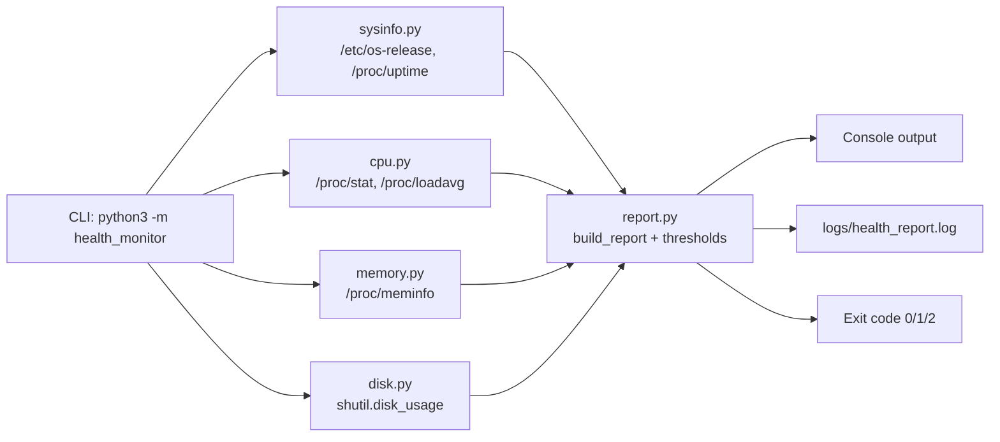

# Linux Server Health Monitor: Project Documentation

| | |
|---|---|
| **Project** | Linux Server Health Monitor |
| **Author** | Chigurupati Prem Kumar |
| **Technologies** | Linux, Python 3 (standard library), Git, GitHub, cron |
| **Version** | 1.0.0 |
| **Date** | November 2026 |

---

## 1. Objective

Build a Python tool that monitors the health of a Linux server and reports **CPU usage, memory usage, disk usage and system information**, produces a health report, saves it to a log file, and is version-controlled on GitHub.

### Requirements and where each is met

| # | Requirement | Implementation |
|---|---|---|
| 1 | Check CPU utilization | `health_monitor/cpu.py` reads `/proc/stat` twice and computes busy %; also load average from `/proc/loadavg` |
| 2 | Check RAM usage | `health_monitor/memory.py` parses `/proc/meminfo` (RAM and swap) |
| 3 | Check disk utilization | `health_monitor/disk.py` uses `shutil.disk_usage()` per mount point |
| 4 | Display system information | `health_monitor/sysinfo.py`: hostname, OS, kernel, architecture, IP, uptime |
| 5 | Generate a health report | `health_monitor/report.py`: thresholds, OK/WARNING/CRITICAL, text or JSON |
| 6 | Save the report in a log file | `report.save_report()` appends to `logs/health_report.log` with rotation |
| 7 | Upload to GitHub | Git repository with README, docs, tests, `.gitignore` (section 8) |

---

## 2. Why these design choices

- **No third-party packages.** Libraries such as `psutil` need `pip install`, which is often blocked or undesirable on production servers. Reading `/proc` directly shows how Linux exposes metrics and means the tool runs on any machine with Python 3.8+.
- **One module per check.** CPU, memory, disk and system info are independent, so each can be tested and changed on its own.
- **File paths as parameters.** Every function that reads `/proc` takes the path as an argument. Tests pass in sample files from `tests/fixtures/`, so the parsing logic can be tested without a live Linux server.
- **Exit codes.** `0 / 1 / 2` for OK / WARNING / CRITICAL follows the Nagios plugin convention, so the tool can plug into cron, shell scripts, Jenkins or monitoring systems.
- **Log rotation.** `RotatingFileHandler` caps the log at 1 MB and keeps 5 old files, so a cron job can't fill the disk it is monitoring.

---

## 3. Architecture



### Flow of one run

1. `__main__.py` parses command-line options (disks, thresholds, log file, watch mode).
2. Each collector gathers its metrics and returns a plain dictionary.
3. `build_report()` compares each value with its thresholds and sets a status. The overall status is the worst individual status.
4. `format_report()` turns the dictionary into a readable text report (or `--json` keeps it as JSON).
5. `save_report()` appends the report to the log file; the report is also printed.
6. The process exits with a code matching the overall status.

---

## 4. How each metric is calculated

### 4.1 CPU utilization (`cpu.py`)

The first line of `/proc/stat` holds cumulative CPU time (in "jiffies") since boot:

```
cpu  user nice system idle iowait irq softirq steal guest guest_nice
```

A single reading only gives totals since boot, so the tool takes **two readings `interval` seconds apart** (default 1 s):

```
idle  = idle + iowait
total = user + nice + system + idle + iowait + irq + softirq + steal
CPU % = (1 - Δidle / Δtotal) × 100
```

`guest` and `guest_nice` are excluded because the kernel already counts them inside `user` and `nice`.

**Worked example (from the test fixtures):**
sample 1 → idle 8500, total 10000; sample 2 → idle 9100, total 11000.
Δidle = 600, Δtotal = 1000 → CPU = (1 − 0.6) × 100 = **40 %**.

Load average (`/proc/loadavg`) is reported for 1, 5 and 15 minutes together with the number of cores, because a load above the core count means work is queuing.

### 4.2 Memory (`memory.py`)

`/proc/meminfo` values are in kB and converted to bytes. Used memory follows the same rule as the `free` command:

```
used  = MemTotal − MemAvailable
RAM % = used / MemTotal × 100
```

`MemAvailable` already excludes reclaimable page cache and buffers, so cached files are not counted as "used". Kernels older than 3.14 don't have `MemAvailable`; for those the tool falls back to `MemFree + Buffers + Cached`. Swap usage is `SwapTotal − SwapFree`.

### 4.3 Disk (`disk.py`)

`shutil.disk_usage(path)` (a wrapper around the `statvfs` system call) returns total, used and free bytes for the filesystem holding `path`. Each path given with `--disk` is checked; a path that can't be read is reported as `CRITICAL` with the error message instead of crashing the tool.

### 4.4 System information (`sysinfo.py`)

| Field | Source |
|---|---|
| Hostname | `socket.gethostname()` |
| OS | `PRETTY_NAME` in `/etc/os-release` |
| Kernel / architecture | `platform.release()` / `platform.machine()` |
| IP address | opens a UDP socket towards 8.8.8.8 and reads the local address (no packet is sent) |
| Uptime | first number in `/proc/uptime`, formatted as days/hours/minutes |

---

## 5. Health status rules

| Check | WARNING at | CRITICAL at | Override with |
|---|---|---|---|
| CPU | 75 % | 90 % | `--cpu-warn`, `--cpu-crit` |
| Memory | 75 % | 90 % | `--mem-warn`, `--mem-crit` |
| Disk (each mount) | 80 % | 90 % | `--disk-warn`, `--disk-crit` |

The overall status is the most severe of all checks. Every non-OK check is listed under **ALERTS** in the report.

---

## 6. Step-by-step setup on a Linux server (e.g. AWS EC2)

1. **Launch a server.** For example, an EC2 `t2.micro` with Ubuntu 24.04 or Amazon Linux 2023. Allow SSH (port 22) from your IP in the security group.
2. **Connect:**
   ```bash
   ssh -i my-key.pem ubuntu@<public-ip>      # Amazon Linux: ec2-user@<public-ip>
   ```
3. **Install Git and check Python** (both are usually preinstalled):
   ```bash
   sudo apt update && sudo apt install -y git python3     # Ubuntu/Debian
   sudo dnf install -y git python3                        # Amazon Linux / RHEL
   python3 --version
   ```
4. **Clone and run:**
   ```bash
   git clone https://github.com/<your-username>/server-health-monitor.git
   cd server-health-monitor
   python3 -m health_monitor
   ```
5. **View the log:**
   ```bash
   cat logs/health_report.log
   ```
6. **Schedule it** (every 5 minutes):
   ```bash
   bash scripts/install_cron.sh
   crontab -l
   ```
7. **Test the alerts.** Lower a threshold so a WARNING appears, or create CPU load:
   ```bash
   python3 -m health_monitor --cpu-warn 1
   yes > /dev/null &  python3 -m health_monitor ; kill %1
   ```

---

## 7. Testing

The project has **19 unit tests** in `tests/test_health_monitor.py`, using Python's built-in `unittest`:

```bash
python3 -m unittest discover -s tests -v
```

| Area | What is tested |
|---|---|
| CPU | parsing `/proc/stat`, usage maths (40 % example), zero-delta case, load average, full `get_cpu_usage()` with mocked samples |
| Memory | bytes conversion, used/available/percent, swap %, fallback when `MemAvailable` is missing |
| Disk | percentage from mocked `disk_usage`, error handling for a missing path |
| System info | OS name from `os-release`, uptime formatting, required keys |
| Report | threshold boundaries, overall status = worst check, byte formatting, report text and alerts, log file appending twice, JSON log line |

Because the tests read files from `tests/fixtures/` instead of the live `/proc`, they give the same result on every machine.

---

## 8. Git and GitHub workflow

```bash
# one-time identity setup
git config --global user.name  "Chigurupati Prem Kumar"
git config --global user.email "you@example.com"

# create the local repository
cd server-health-monitor
git init -b main
git add .
git commit -m "Linux server health monitor: CPU, memory, disk, system info, logging"

# create an empty repository named server-health-monitor on github.com, then:
git remote add origin https://github.com/<your-username>/server-health-monitor.git
git push -u origin main
```

`.gitignore` keeps generated files (`__pycache__/`, `logs/*.log`) out of the repository, while `logs/.gitkeep` keeps the empty `logs/` folder.

For later changes:

```bash
git checkout -b feature/email-alerts
# ...edit, test...
git add . && git commit -m "Add email alerts"
git push -u origin feature/email-alerts      # then open a Pull Request on GitHub
```

---

## 9. Sample output

The report below shows the format, using the values from the test fixtures. On a real server the numbers come from that machine.

```text
============================================================
              LINUX SERVER HEALTH REPORT
============================================================
Generated     : 2026-11-10 10:00:00
Overall status: WARNING

[ SYSTEM INFORMATION ]
  Hostname     : web-01
  OS           : Ubuntu 24.04 LTS
  Kernel       : 6.8.0-1012-aws
  Architecture : x86_64
  IP address   : 172.31.20.15
  Uptime       : 3 days, 4 hours, 0 minutes
  Python       : 3.12.3

[ CPU ]                                   OK
  Usage        : 40.0 %
  Cores        : 2
  Load average : 0.52 (1m)  0.38 (5m)  0.30 (15m)

[ MEMORY ]                                WARNING
  Usage        : 75.0 %
  Used / Total : 5.7 GB / 7.6 GB
  Available    : 1.9 GB
  Swap         : 488.3 MB / 1.9 GB (25.0 %)

[ DISK ]
  /            : 52.3 %  (15.7 GB used of 30.0 GB, 14.3 GB free)    OK

[ ALERTS ]
  - Memory usage 75.0% is WARNING (warning 75.0%, critical 90.0%)
============================================================
```

JSON mode (`--json`) writes the same data as one JSON object per line, which is easy to feed into tools such as CloudWatch Logs, ELK or Grafana Loki.

---

## 10. Challenges and how they were solved

| Challenge | Solution |
|---|---|
| A single `/proc/stat` read gives CPU time since boot, not current usage | Take two samples and use the difference |
| "Free" memory looks very low on Linux because of page cache | Use `MemAvailable`, matching the `free` command |
| Testing Linux-only code on other machines | All `/proc` paths are function parameters; tests use fixture files |
| A scheduled job writing logs forever could fill the disk | `RotatingFileHandler` (1 MB × 5 files) |
| An unreadable mount point could crash the run | Each disk is checked separately; errors are reported, not raised |

---

## 11. Possible enhancements

- Email or Slack alerts when the status is WARNING or CRITICAL
- Per-process top CPU/memory consumers
- Network traffic and open-port checks
- Push metrics to AWS CloudWatch as custom metrics
- Run as a `systemd` service/timer instead of cron
- GitHub Actions workflow that runs the tests on every push

---

## 12. Resume summary

> **Linux Server Health Monitor** (Python, Linux, Git/GitHub)
> - Built a dependency-free Python tool that reports CPU (from `/proc/stat` deltas), memory, disk and system information on Linux servers, with OK/WARNING/CRITICAL thresholds.
> - Generated human-readable and JSON health reports, saved to rotating log files and scheduled with cron; exit codes integrate with monitoring tools.
> - Wrote 19 unit tests using fixture `/proc` files; managed the project with Git and published it on GitHub.
